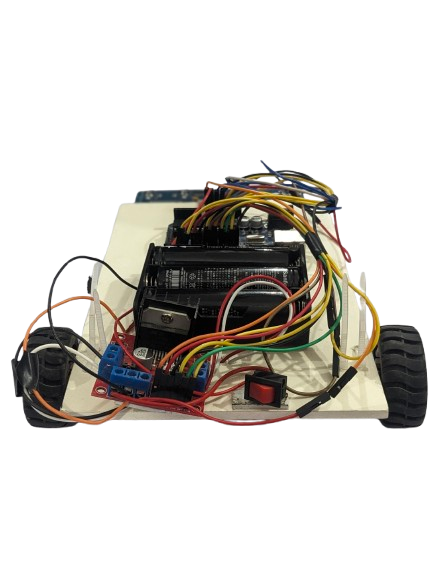

# PID-Based Line Following Robot

An Arduino-based autonomous Line Following Robot (LFR) developed using a 5-channel TCRT5000L infrared sensor array, L298N motor driver, and two N20 DC motors. The robot uses a PID control algorithm to detect a line and adjust motor speeds for autonomous navigation.

## Project Overview

The robot detects a predefined track using five infrared sensors. Based on the sensor readings, it calculates the position error and applies a PID controller to adjust the speed of the two DC motors.

The implementation includes:
- Five-channel infrared line detection.
- Weighted sensor-based error calculation.
- PID-based motor speed correction.
- Dynamic base-speed adjustment.
- Line-loss detection and recovery using the last known error.

## Hardware Components

| Component | Quantity |
|---|---:|
| L298N H-Bridge Motor Driver | 1 |
| N20 DC Motor (400 RPM) | 2 |
| TCRT5000L 5-Channel IR Sensor Array | 1 |
| Wheels for N20 Motors | 2 |
| Ball Caster | 1 |
| 18650 Lithium-Ion Batteries | 3 |
| Battery Holder | 1 |
| KCD11 Power Switch | 1 |
| Jumper Wires | As required |

## Hardware Assembly

Add photographs of the completed robot here.



## Software and Technologies

- Arduino C/C++
- PID Control Algorithm
- Infrared Sensor-Based Line Detection
- PWM Motor Speed Control
- L298N H-Bridge Motor Driver

## Pin Configuration

### Motor Driver

| L298N Pin | Arduino Pin | Function |
|---|---|---|
| ENA | D3 | Right Motor PWM |
| IN1 | D4 | Right Motor Direction |
| IN2 | D5 | Right Motor Direction |
| ENB | D9 | Left Motor PWM |
| IN3 | D6 | Left Motor Direction |
| IN4 | D7 | Left Motor Direction |

### IR Sensor Array

| Sensor | Arduino Pin | Position |
|---|---|---|
| IR1 | D13 | Leftmost |
| IR2 | D12 | Left |
| IR3 | D11 | Middle |
| IR4 | D10 | Right |
| IR5 | D8 | Rightmost |

## PID Controller Configuration

The current PID parameters are:

| Parameter | Value |
|---|---:|
| Kp | 10.0 |
| Ki | 0.9 |
| Kd | 5.0 |
| Base Speed | 140 |
| Maximum Speed | 200 |

The sensor weights are:

`[-2, -1, 0, 1, 2]`

The weighted sensor readings are used to calculate the line position error. The PID controller then determines the correction required to adjust the motor speeds.

## How It Works

1. The five IR sensors detect the line using infrared reflection.
2. The Arduino reads the sensor states.
3. A weighted average is used to calculate the position error.
4. The PID controller calculates the correction value.
5. The motor speeds are adjusted according to the PID output.
6. If all sensors lose the line, the robot attempts to recover using its last known error.

## Installation and Usage

1. Clone this repository:

   ```bash
   git clone https://github.com/YOUR_USERNAME/PID-Line-Follower-Robot.git
   ```

2. Open the project directory.
3. Open `Code/PID_Line_Follower/PID_Line_Follower.ino` in Arduino IDE.
4. Connect the Arduino board to your computer.
5. Select the appropriate board and COM port.
6. Upload the program.
7. Place the robot on a suitable line-following track and test its operation.
