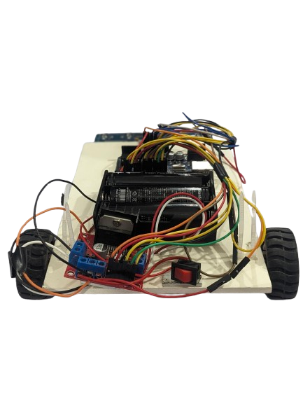
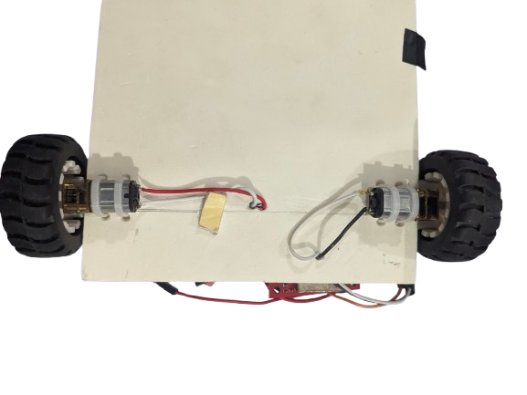
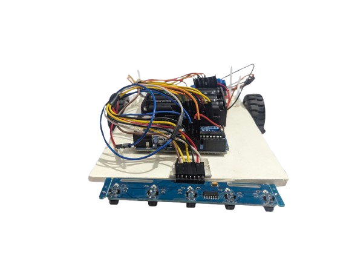

# Hardware Components

This project uses an Arduino-based embedded system to develop an autonomous PID Line Following Robot. The hardware consists of a five-channel infrared sensor array, a dual H-bridge motor driver, two DC geared motors, a power supply, and a mechanical chassis.

## Components List

| No. | Component Name | Specification / Model | Quantity |
|:---:|---|---|:---:|
| 1 | Motor Driver | L298N Dual H-Bridge | 1 |
| 2 | DC Geared Motor | N20, 400 RPM | 2 |
| 3 | IR Sensor Array | TCRT5000L, 5-Channel Line Tracking Sensor | 1 |
| 4 | Wheels | Compatible with N20 Motors | 2 |
| 5 | Ball Caster | Ball Cluster | 1 |
| 6 | Lithium-Ion Battery | 18650 Rechargeable Battery | 3 |
| 7 | Battery Holder | Compatible with 3 × 18650 Cells | 1 |
| 8 | Power Switch | KCD11 Rocker Switch | 1 |
| 9 | Jumper Wires | Male-to-Male and Male-to-Female | As required |

## Component Description

### 1. L298N Motor Driver

The L298N is a dual H-bridge motor driver used to control the direction and speed of the two DC motors. It receives control signals from the Arduino and provides the necessary motor-driving outputs.

- Controls two DC motors independently.
- Supports forward and reverse motor rotation.
- Uses PWM signals for motor speed control.
- Provides separate enable and direction control pins for each motor.

### 2. N20 DC Geared Motors

Two N20 geared DC motors rated at 400 RPM are used to drive the robot.

- Provide mechanical movement to the robot.
- Allow independent speed control of the left and right wheels.
- Enable turning by varying the relative speeds and directions of the motors.

### 3. TCRT5000L 5-Channel IR Sensor Array

The five-channel infrared sensor array detects the line on the track using infrared reflection.

- Contains five infrared sensing channels.
- Detects differences in infrared reflection between the line and the surrounding surface.
- Sends digital signals to the Arduino.
- Provides the sensor information required for line-position error calculation.

### 4. Wheels and Ball Caster

Two wheels are attached to the N20 motors to provide traction and movement. A ball caster supports the robot and allows it to move smoothly while changing direction.

### 5. Power Supply

Three 18650 rechargeable lithium-ion batteries are used as the power source. A compatible battery holder keeps the batteries in position, while a KCD11 rocker switch controls the main power supply.

**Note:** The battery connection configuration and operating voltage should be documented according to the actual wiring.

### 6. Jumper Wires

Male-to-male and male-to-female jumper wires are used to establish electrical connections between the Arduino, motor driver, IR sensor array, and other components.

## Hardware Assembly

The components are mounted on the robot chassis. The two N20 motors are connected to the L298N motor driver, while the five-channel IR sensor array is positioned to detect the line beneath the robot.

The Arduino processes the sensor signals and sends control commands to the motor driver. The battery pack supplies power to the system.

## Hardware Overview

Add photographs of the completed robot below.

<!-- Replace the image paths with your actual uploaded photographs. -->

 

 

